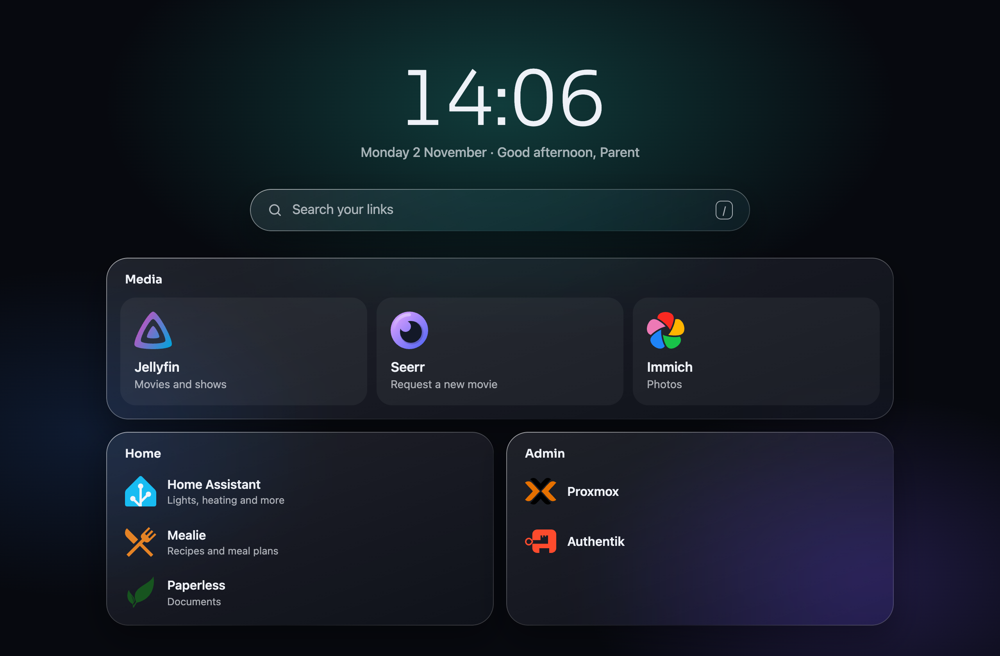

# Homenclature

[](https://github.com/NiekKeijzer/homenclature/actions/workflows/ci.yml)
[](https://hub.docker.com/r/niekkeijzer/homenclature)
[](https://hub.docker.com/r/niekkeijzer/homenclature)
[](go.mod)
[](LICENSE)

A family-first start page for the self-hosted home: one calm, glass-styled place where everyone in the household finds the apps and links they need.



## Why

There are plenty of homepage dashboards, but most are built for whoever runs the server: service status, widgets, every container you own. The rest of the household needs none of that. They need the few apps they actually use, and not the admin pages they shouldn't touch.

Homenclature shows each person only the links for their groups. Everyone logs in with the account they already have (OIDC), and you manage it all in one TOML file. No database, no admin UI.

## Features

- **Links per group.** Each OIDC group gets its own dashboard. Someone in several groups gets one merged page.
- **Search.** Type to filter your links. `/` jumps to the search box and Enter opens the first match.
- **Icons by name.** Use any name from [dashboard-icons](https://github.com/homarr-labs/dashboard-icons), or a URL. The server fetches and caches them.
- **Light and dark.** Follows the system, and fits phones edge to edge.
- **Small.** A single Go binary in a ~5 MB distroless image for amd64 and arm64.

## Run it

```yaml
# compose.yaml
services:
  homenclature:
    image: ghcr.io/niekkeijzer/homenclature:latest # or docker.io/niekkeijzer/homenclature
    ports:
      - "8000:8000"
    volumes:
      - ./config.toml:/config/config.toml:ro
    environment:
      HOMENCLATURE_URL: https://home.example.com
      HOMENCLATURE_OIDC_ISSUER: https://auth.example.com/application/o/homenclature/
      HOMENCLATURE_OIDC_CLIENT_ID: homenclature
      HOMENCLATURE_OIDC_CLIENT_SECRET: "" # from your identity provider
      HOMENCLATURE_SESSION_SECRET: "" # at least 32 characters, e.g. `openssl rand -base64 32`
```

In your identity provider, create an OIDC client with the redirect URI `https://home.example.com/auth/callback`. Homenclature asks for the `openid profile email` scopes and reads group names from the `groups` claim. Authentik sends that claim by default.

Image tags: `latest` and versions like `0.1.0` and `0.1` for releases, `edge` for the latest commit on `main`.

### Settings

| Variable | |
| --- | --- |
| `HOMENCLATURE_URL` | Required. The public URL of the page. |
| `HOMENCLATURE_OIDC_ISSUER`, `_CLIENT_ID`, `_CLIENT_SECRET` | Required. Your OIDC client. |
| `HOMENCLATURE_SESSION_SECRET` | Required, at least 32 characters. Encrypts the login cookie (valid for 24 hours). |
| `HOMENCLATURE_DEFAULT_DASHBOARD` | Dashboard for people in none of the groups. Unset: they see no links. |
| `HOMENCLATURE_CONFIG` | Path to the config file. Default `/config/config.toml` in Docker. |
| `HOMENCLATURE_LISTEN` | Listen address. Default `:8000`. |

## Configure

Dashboards are keyed by group name. Each has sections, and each section has links.

```toml
# Everyone in the "family" group
[[dashboards.family.sections]]
title = "Media"
layout = "cards" # big cards; the default is a list

[[dashboards.family.sections.links]]
title = "Jellyfin"
url = "https://jellyfin.home.example"
icon = "jellyfin"
description = "Movies and shows"

# Only the "parents" group
[[dashboards.parents.sections]]
title = "Admin"

[[dashboards.parents.sections.links]]
title = "Proxmox"
url = "https://pve.home.example"
icon = "proxmox"
```

See [config.example.toml](config.example.toml) for every field and how pages merge.

## Develop

You need [mise](https://mise.jdx.dev) and Docker.

```sh
mise install     # Go and the dev tools
mise run oidc    # mock OIDC server on :8080
mise run dev     # http://localhost:8000, reloads when you save
mise run check   # lint and tests
```

On the mock login form, sign in as `parent` or `kid` to see their pages.

## License

[MIT](LICENSE). The bundled Sora font is under the [SIL Open Font License](internal/server/web/static/fonts/OFL.txt).
