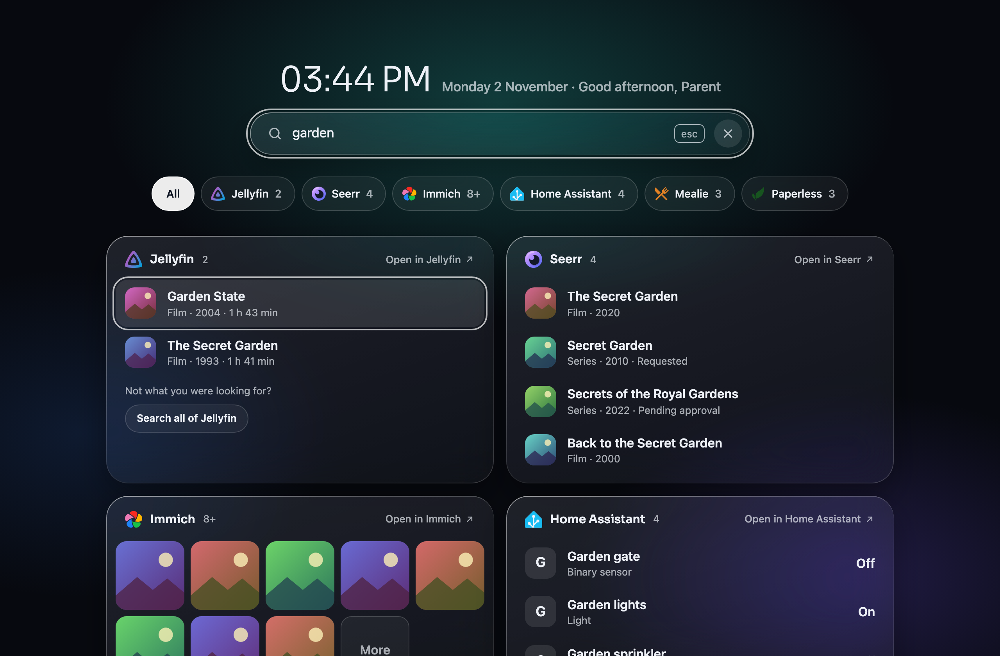
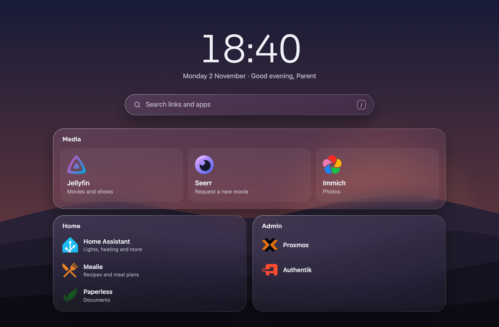
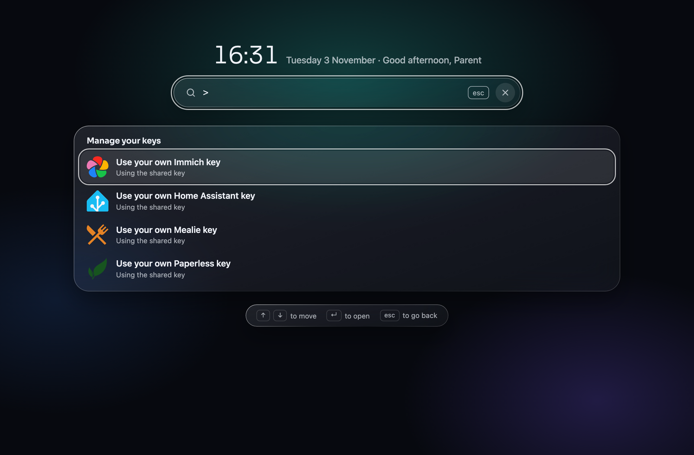

# Homenclature

[](https://github.com/NiekKeijzer/homenclature/actions/workflows/ci.yml)
[](https://hub.docker.com/r/niekkeijzer/homenclature)
[](https://hub.docker.com/r/niekkeijzer/homenclature)
[](go.mod)
[](LICENSE)

A family-first start page for the self-hosted home: one calm, glass-styled place where everyone in the household finds the apps and links they need.





## Why

There are plenty of homepage dashboards, but most are built for whoever runs the server: service status, widgets, every container you own. The rest of the household needs none of that. They need the few apps they actually use, and not the admin pages they shouldn't touch.

Homenclature shows each person only the links for their groups. Everyone logs in with the account they already have (OIDC), and you manage it all in one TOML file. No database, no admin UI.

## Features

- **Links per group.** Each OIDC group gets its own dashboard. Someone in several groups gets one merged page.
- **Search.** Type to filter your links. `/` jumps to the search box and Enter opens the first match. Start with `>` for commands instead.
- **Search inside your apps.** Opt in per app and the same box also finds films in Jellyfin, photos in Immich, recipes in Mealie, documents in Paperless and devices in Home Assistant. Results link straight to the item. Search only reads; it never changes anything in your apps.
- **Your own keys.** People can search Home Assistant, Immich, Mealie and Paperless with their own API key, set with a command in the search box, so they find what their account can see. Keys stay encrypted in their browser; the server stores nothing.
- **Request what's missing.** With Seerr opted in, search also lists matching films and shows that aren't in your library yet. One click opens the title in Seerr to request it.
- **Icons by name.** Use any name from [dashboard-icons](https://github.com/homarr-labs/dashboard-icons), or a URL. The server fetches and caches them.
- **Backgrounds.** Keep the glow, or pick hills under a sky that follows the time of day, your own photos, or an Immich album.
- **Light and dark.** Follows the system, and fits phones edge to edge.
- **Small.** A single Go binary in a ~5 MB distroless image for amd64 and arm64.

## Run it

```yaml
# compose.yaml
services:
  homenclature:
    image: ghcr.io/niekkeijzer/homenclature:latest # or docker.io/niekkeijzer/homenclature
    ports:
      - "8000:8000"
    volumes:
      - ./config.toml:/config/config.toml:ro
      # - ./backgrounds:/backgrounds:ro # your photos, for HOMENCLATURE_BACKGROUND=folder
    environment:
      HOMENCLATURE_URL: https://home.example.com
      HOMENCLATURE_OIDC_ISSUER: https://auth.example.com/application/o/homenclature/
      HOMENCLATURE_OIDC_CLIENT_ID: homenclature
      HOMENCLATURE_OIDC_CLIENT_SECRET: "" # from your identity provider
      HOMENCLATURE_SESSION_SECRET: "" # at least 32 characters, e.g. `openssl rand -base64 32`
```

In your identity provider, create an OIDC client with the redirect URI `https://home.example.com/auth/callback`. Homenclature asks for the `openid profile email` scopes and reads group names from the `groups` claim. Authentik sends that claim by default.

Image tags: `latest` and versions like `0.1.0` and `0.1` for releases, `edge` for the latest commit on `main`.

### Settings

| Variable | |
| --- | --- |
| `HOMENCLATURE_URL` | Required. The public URL of the page. |
| `HOMENCLATURE_OIDC_ISSUER`, `_CLIENT_ID`, `_CLIENT_SECRET` | Required. Your OIDC client. |
| `HOMENCLATURE_SESSION_SECRET` | Required, at least 32 characters. Encrypts the login cookie (valid for 24 hours). |
| `HOMENCLATURE_DEFAULT_DASHBOARD` | Dashboard for people in none of the groups. Unset: they see no links. |
| `HOMENCLATURE_BACKGROUND` | `default`, `landscape`, `folder` or `immich`. See Background below. |
| `HOMENCLATURE_BACKGROUND_INTERVAL` | Time between photos. Default `10m`, at least `1m`. |
| `HOMENCLATURE_BACKGROUND_DIR` | Folder with photos for `folder`. Default `/backgrounds` in Docker. |
| `HOMENCLATURE_BACKGROUND_IMMICH_ALBUM` | Album ID for `immich`. |
| `HOMENCLATURE_CONFIG` | Path to the config file. Default `/config/config.toml` in Docker. |
| `HOMENCLATURE_LISTEN` | Listen address. Default `:8000`. |
| Your app tokens | For search inside apps: one env var per app, named in the config (`token_env`). |
| Your app URLs | Optional: any URL in the config can come from an env var you name instead (`url_env`, `api_url_env`, `seerr_url_env`). |

## Configure

Dashboards are keyed by group name. Each has sections, and each section has links.

```toml
# Everyone in the "family" group
[[dashboards.family.sections]]
title = "Media"
layout = "cards" # big cards; the default is a list

[[dashboards.family.sections.links]]
title = "Jellyfin"
url = "https://jellyfin.home.example"
icon = "jellyfin"
description = "Movies and shows"

# Only the "parents" group
[[dashboards.parents.sections]]
title = "Admin"

[[dashboards.parents.sections.links]]
title = "Proxmox"
url = "https://pve.home.example"
icon = "proxmox"
```

### Search inside apps

Add a `search` table to a link to search that app from the search box. The API token comes from the env var you name in `token_env`, never from the file.

```toml
[[dashboards.family.sections.links]]
title = "Jellyfin"
url = "https://jellyfin.home.example"
icon = "jellyfin"
search = { type = "jellyfin", token_env = "JELLYFIN_TOKEN", seerr_url = "https://seerr.home.example" }
```

Types: `home-assistant`, `immich`, `jellyfin`, `mealie`, `paperless` and `seerr`. Optional for all: `api_url` (where the server reaches the app, e.g. `http://jellyfin:8096`) and `limit` (results shown). Jellyfin also takes `types` (which kinds of items) and `seerr_url` (adds "Request it in Seerr" for people who can't search Seerr itself). Home Assistant takes `domains`, e.g. `["light", "sensor"]`.

URLs can come from env vars too: write `url_env`, `api_url_env` or `seerr_url_env` with the env var's name instead of `url`, `api_url` or `seerr_url`. Set one or the other; the app won't start if the env var is unset.

Searches run with that token, so results show what the token can see, to anyone with the link on their page. Give each group its own token where that matters (e.g. a kids' Jellyfin user).

See [config.example.toml](config.example.toml) for every field, which token each app needs, and how pages merge.

#### Your own keys

For Home Assistant, Immich, Mealie and Paperless, people can use their own API key instead of the shared one. Type `>` in the search box for commands and choose "Manage your keys" (or type the app's name, e.g. `> immich`), then pick "Use your own … key" and paste the key into the box. A key is tried in the app before it's saved, and from then on that person's searches use it. The same list replaces or removes a key.

There's no database: keys are kept in an encrypted cookie in that browser, tied to the person's login, for about a year after their last visit. On another device they add them again. Changing `HOMENCLATURE_SESSION_SECRET` clears everyone's keys, and searches go back to the shared token. Jellyfin (only admins make API keys) and Seerr (one admin key) always use the shared token.

### Background

`HOMENCLATURE_BACKGROUND` sets the background for everyone:

- `default`: the glow.
- `landscape`: hills under a sky that follows the time of day, in soft colours in light mode and deep ones in dark mode.
- `folder`: your own photos (JPEG, PNG, WebP or AVIF), from a folder you mount at `/backgrounds`. The container doesn't run as root, so the files must be readable by everyone.
- `immich`: photos from an Immich album. Set `HOMENCLATURE_BACKGROUND_IMMICH_ALBUM` to the album's ID, the last part of its URL. It uses the key of the Immich link with search in your config (the first, if there are several), so that key's user must be able to see the album.

Photos show in random order, each once before any repeats, and change every 10 minutes (`HOMENCLATURE_BACKGROUND_INTERVAL`, e.g. `30m`).

## Develop

You need [mise](https://mise.jdx.dev) and Docker.

```sh
mise install     # Go, Node and the dev tools
mise run oidc    # mock OIDC server on :8080
mise run dev     # http://localhost:8000, reloads when you save
mise run check   # lint and tests
```

On the mock login form, sign in as `parent` or `kid` to see their pages.

## License

[MIT](LICENSE). The bundled Sora font is under the [SIL Open Font License](https://github.com/sora-xor/sora-font/blob/master/OFL.txt).
